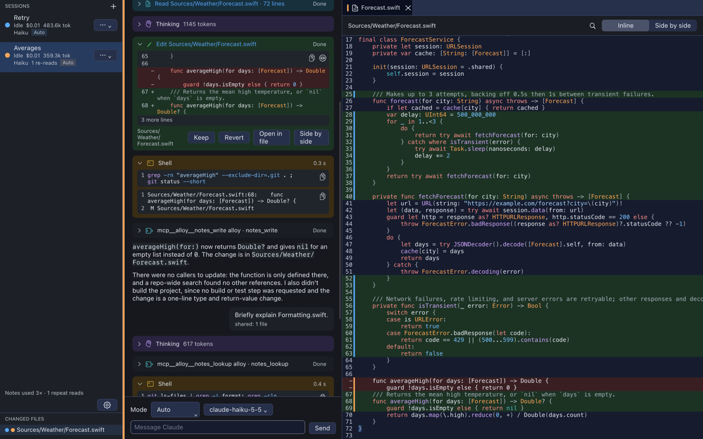
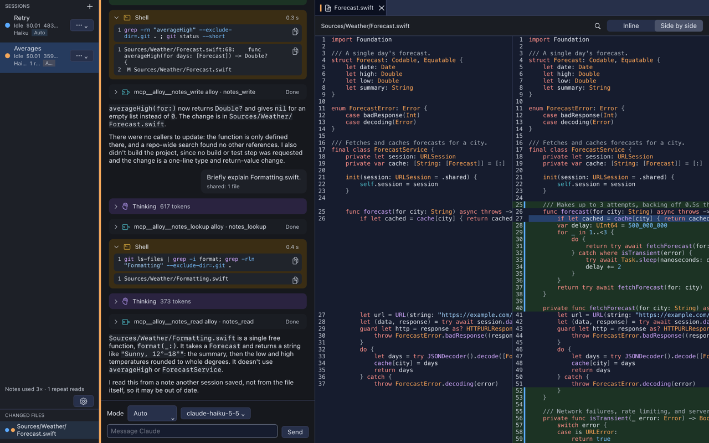
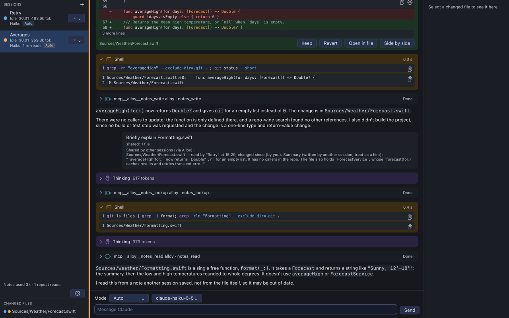

# Alloy

Alloy is a native macOS code editor built around AI coding sessions. It runs several sessions on a project folder at
the same time, shows every change each session makes as a live diff attributed to that session, and lets the sessions
share what they have already read. [Claude Code](https://claude.com/claude-code) is supported directly. Codex, Gemini
CLI, OpenCode, Goose and custom agents work too.

You are not limited to one repository at a time: each Alloy window holds one project, and you can run several windows
side by side, one per repository, each with its own sessions, diffs and history.

It is built on [MetalUI](https://github.com/mburger89/MetalUI), a GPU-rendered Swift UI framework.



## Install

1. Download `Alloy.dmg` from the [Releases page](https://github.com/mburger89/Alloy/releases).
2. Drag Alloy to Applications and open it.
3. Choose a project folder.
4. Install an agent and sign in to it.

Alloy needs a Mac with Apple silicon and macOS 14 or later. Alloy does not install agents. Claude Code is supported
directly: see [claude.com/claude-code](https://claude.com/claude-code). Other agents are listed under
[Other agents](#other-agents).

## Why

Running more than one agent on a project works until you cannot tell who changed what, and until each agent re-reads
the same files. Alloy is an editor designed around that situation:

- Every character in a file is attributed to the session that wrote it, to you, or to an outside change.
- Several sessions in one repository, or one session per repository in separate windows, share what they have learned, so the next session does not start from zero. "Share with other projects" in Settings turns the cross-project part off.
- Chat is a first-class surface (tool blocks, diffs, plans, questions), not a terminal.

## Features

### Sessions and chat

- Several sessions at once, each with streaming chat, collapsible thinking, tool blocks that show input and result,
  permission cards, and interrupt.
- Question cards (answer and send) and plan cards (approve, or send back with feedback).
- Markdown replies with headings, lists, tables and syntax-highlighted code blocks with a Copy button.
- Composer with `@file` and slash-command completion, image paste and drop, queued sends, and mode and model controls.
- Slash commands, handled by Alloy or passed to the agent; see [docs/slash-commands.md](docs/slash-commands.md).
- Rename and fork sessions (`/fork [name]`). History replays when a session is resumed.
- Sessions and the edit ledger persist per project. After a relaunch sessions show as "Paused" and resume on the next
  message.

### Who changed what

- A per-file edit ledger with author gutter bars and tints, removed lines shown inline, and Keep and Revert per edit.
- Side-by-side diff with synchronised scrolling.

  

- Edits by other programs show as "outside". Changes made by a session's shell commands are attributed to that
  session. `git commit` clears the reviewed files' baseline.
- If a session changes a file while you have unsaved edits, the changes are merged.

### Working together

- Sessions share what they have read through small notes. When a message names a file another session has read, Alloy
  adds a short note saying whether the file changed since. Notes are hints, and are not served once the file changes.

  

- Overlap warnings, which never block an edit. When a session is about to change lines that another session, or you
  with unsaved typing, has changed or is changing, the agent gets a short note and a notice appears in the chats
  involved.
- Sessions can message each other and claim a region of a file. A claim is a hint, not a lock.
- When two parties change the same lines back and forth, Alloy raises an alert and tells the session that just edited
  to move on.
- Warnings show as marks on the affected sessions and files in the sidebar. "Ask before sessions use Alloy's tools" in
  Settings makes the agent ask first.

### Code mode

- Switch between Chat and Code. Code mode has a file tree, tabs, split panes and a narrow chat column.
- Tree-sitter syntax highlighting for Swift, Python, JavaScript, TypeScript, TSX, JSON, Markdown, Bash, Rust, Go, C,
  C++, YAML, HTML and CSS. Large and non-UTF-8 files open read-only.
- Multiple cursors, code folding, find, quick open (Cmd-P), a command palette, and rebindable keyboard shortcuts.
- Project-wide search and replace with regular expressions and include and exclude globs; results respect `.gitignore`.
- Git: change bars in the gutter, blame, compare with the last commit, stage, commit and switch branches.
- A built-in terminal running your login shell.
- Language servers, described below.

### Language servers

Alloy uses the language servers you already have installed. It gives you diagnostics and linter warnings, completion,
signature help, hover, go to definition and references, rename, quick fixes and formatting. F8 and Shift-F8 jump to
the next and previous problem, and F12 goes to a definition. The file header shows the server's name and state.

When you open a file, Alloy picks the enabled server for its extension and looks for the server's command in the PATH
of your login shell, so tools in `~/.cargo/bin` or Homebrew are found even though Alloy starts from the Dock. Nothing
starts until you open a file a server handles. Files over 1 MiB are never sent to a server. A server that crashes is
restarted at most three times in five minutes, then shown as failed.

Built in: rust-analyzer, sourcekit-lsp, typescript-language-server, pyright, gopls, clangd, lua-language-server, zls,
ruby-lsp, elixir-ls, bash-language-server, yaml-language-server, the VS Code JSON, CSS and HTML servers, marksman,
taplo, kotlin-language-server, jdtls, ocamllsp, haskell-language-server, dart, terraform-ls and nil. Settings has a
"Language servers" section: one row per server with its extensions, whether its command was found, and an on/off
switch.

You can configure servers under `languageServers` in `~/Library/Application Support/Alloy/settings.json`, keyed by
server id. Every field is optional; a set field replaces the built-in value.

```json
{
  "languageServers": {
    "rust-analyzer": { "command": "/opt/homebrew/bin/rust-analyzer" },
    "gopls": { "enabled": false },
    "my-lang": {
      "name": "My Lang",
      "command": "my-lang-server",
      "arguments": ["--stdio"],
      "extensions": ["ml2", "mli2"],
      "languageID": "mylang",
      "languageIDs": { "mli2": "mylang-interface" }
    }
  }
}
```

An id that is not built in adds a server; it needs a `command` and `extensions` (or `fileNames`). Other keys:
`name`, `fileNames`, `initializationOptions`. A change made in Settings applies to open files at once; edits to
settings.json are read at launch. A malformed entry is ignored, and the rest of the file still applies.

Alloy never installs, downloads or updates a server and makes no network requests for this. The servers are your own
binaries, run as your user with the project folder as the working directory. What a server receives: the absolute path
and text of every file you open, kept current as you edit; the project folder's path and name, and Alloy's process id;
the caret position when you ask for a definition; and the `initializationOptions` you configured for it. Nothing else
is sent.

### Themes

Alloy ships six built-in themes: Dracula (the default), Alloy Dark, Alloy Light, Solarized Dark, Solarized Light and
One Dark. Pick one in Settings (Alloy ▸ Settings…, or ⌘,): "One theme" uses a single theme always, "Match system"
uses a light and a dark theme that follow the system appearance. A pick repaints at once and never touches your
sessions.

Your own themes are `*.json` files in the user themes folder, which Alloy watches, so an edit applies live:

- `~/Library/Application Support/Alloy/Themes`
- or `$ALLOY_DATA_DIR/Alloy/Themes` when `ALLOY_DATA_DIR` is set

"Open themes folder" in Settings opens it. The file format and every colour slot are in [docs/themes.md](docs/themes.md).

In a Claude Code session, type `/theme` (optionally followed by a description, such as `/theme warm, low contrast`)
to have it draft a theme. "Make a theme with Claude…" in Settings does the same. The theme shows live on the whole
app, and a bar above the chat offers Keep and Discard. `/theme` is available in Claude Code sessions only.

## Other agents

Claude Code is first-class. Codex, Gemini CLI, OpenCode, Goose and custom agents run over the Agent Client Protocol.
Pick the agent from the New Session menu. Alloy finds installed agents on your login PATH and shows the install
command for the rest; it never installs anything. Chat, permissions, the edit ledger, overlap warnings and shared
notes work as for Claude Code, and agent secrets live only in the Keychain. `/theme` is Claude Code only. See
[docs/acp.md](docs/acp.md).

## Privacy

- No telemetry and no account.
- The only requests Alloy itself makes are update checks. The agents and language servers you run make their own
  connections. You can turn automatic update checks off in Settings.
- Alloy never writes to `~/.claude` or to the project's `.claude/` directory. Its own state lives in
  `~/Library/Application Support/Alloy`.
- Secrets are stored only in the macOS Keychain.
- Alloy's local tool server listens on 127.0.0.1 only, and every session has its own random token.
- Alloy pre-approves only its own tools. Turn on "Ask before sessions use Alloy's tools" in Settings to turn that
  off. Everything else follows your agent's permission settings and asks through permission cards.

## Building from source

### Requirements

- macOS 14 or later.
- Swift 6.1 or later (Xcode 16.3 or later).
- A sibling checkout of MetalUI at `../MetalUI` (`Package.swift` depends on it by path):

  ```sh
  git clone https://github.com/mburger89/MetalUI.git ../MetalUI
  ```


### Build, run and test

```sh
swift build -c release
.build/release/Alloy <project-dir> [file]
swift test
```

- `<project-dir>` is the project; `file` (optional) opens in the code panel at launch. With no arguments Alloy reopens
  the last project, or asks for a folder. `/` and your home folder itself are never accepted as a project.
- To work on several repositories at once, launch Alloy once per repository (for example
  `.build/release/Alloy ~/src/app &` and `.build/release/Alloy ~/src/api &`). Each window keeps its own sessions,
  edit ledger and shared notes; the projects do not interfere with each other. The folder need not be a git repository.
- The tests never launch the real `claude`. Opt-in live tests drive the real CLI against a scratch repository in your
  temporary directory and cost real (small) API usage, on the cheapest model:

  ```sh
  ALLOY_LIVE=1 swift test --filter LiveKnowledgeTests
  ALLOY_LIVE=1 swift test --filter LiveCoordinationTests
  ```

- The absolute timing bounds of `OverlapIndexTests` (the relative ones always run) need `ALLOY_PERF=1`, on a quiet
  machine: `ALLOY_PERF=1 swift test --filter OverlapIndexTests`.

- To package an app bundle: `scripts/bundle-macos.sh [--version X.Y.Z --build N]` produces `build/Alloy.app` (bundle id
  `com.unicornlabs.Alloy`), signed ad hoc by default. `--version` and `--build` set `CFBundleShortVersionString` and
  `CFBundleVersion`. Set `ALLOY_SIGN_IDENTITY` (the older `CODESIGN_IDENTITY` still works) to sign for distribution
  with the hardened runtime and `Packaging/macOS/Alloy.entitlements`. Put a 1024 x 1024 `Packaging/icon-1024.png` in
  place first for an icon.

### Releasing

Releases are cut locally with `scripts/release-macos.sh`; nothing runs in CI. Alloy updates itself through Sparkle
from `https://mburger89.github.io/Alloy/appcast.xml`.

One-time setup:

1. A **Developer ID Application** certificate in the login keychain. `ALLOY_SIGN_IDENTITY` is its name (for example
   `Developer ID Application: Your Name (TEAMID)`).
2. A notarisation profile: `xcrun notarytool store-credentials <profile>` (Apple ID app-specific password or an App
   Store Connect API key). `ALLOY_NOTARY_PROFILE` is the profile name.
3. A Sparkle EdDSA key: run `generate_keys` from Sparkle's tools (`.build/artifacts/sparkle/Sparkle/bin`, present after
   `swift build`). The private key stays in the login keychain; `ALLOY_SPARKLE_PUBLIC_KEY` is the public key it
   prints (`generate_keys -p`). The script refuses to run if it does not match the keychain's key.
4. Release notes in `docs/releases/<version>.md` (Markdown, without the `<!-- PLACEHOLDER -->` marker), and a public
   sync of the exact commit: `tools/publish-public.sh` on a clean `master` equal to `origin/main`.

Environment: `ALLOY_SIGN_IDENTITY`, `ALLOY_NOTARY_PROFILE`, `ALLOY_SPARKLE_PUBLIC_KEY` (all required except for
`--dry-run`); optional `ALLOY_SPARKLE_BIN` (directory with `generate_appcast` and `generate_keys`).

```sh
scripts/release-macos.sh 0.1.0 --dry-run        # ad hoc signing, no notarisation, nothing published
scripts/release-macos.sh 0.1.0                  # the real run; asks "Publish v0.1.0? [y/N]" before uploading
scripts/release-macos.sh 0.1.0 --appcast-only   # redo only the appcast of an already published release
```

The real run bundles and signs (hardened runtime), notarises and staples the app and `Alloy.dmg`, verifies the app
inside the finished DMG, then creates the GitHub Release `v<version>` (stable `Alloy.dmg` plus `Alloy-<version>.dmg`)
and updates `Bench/site/appcast.xml`. Afterwards commit the appcast, push, run `tools/publish-public.sh` and let the
Pages workflow deploy. Every step before the upload fails closed and can simply be rerun. If a run is interrupted
during `gh release create`, remove the partial release before rerunning:
`gh release delete v<version> -R mburger89/Alloy --cleanup-tag`. If only the appcast step failed, use `--appcast-only`.

Verify on the first real run:

- `--dry-run` on `master`: Sparkle is embedded and signed, the Finder layout applies (approve the Automation prompt),
  the detach works, and the DMG opens laid out.
- `notarytool` prints pure JSON with `"status":"Accepted"` for both the app zip and the DMG; `spctl` reports
  "Notarized Developer ID" for the DMG and the app inside it, and `stapler validate` passes.
- The appcast item has `sparkle:version` equal to the commit count, an `edSignature`, the length of
  `Alloy-<version>.dmg`, the `.../releases/download/v<version>/Alloy-<version>.dmg` URL, Markdown notes, minimum
  macOS 14.0 and arm64.
- `curl -IL` on the enclosure URL and on `/releases/latest/download/Alloy.dmg` both end in 200 with the same size.
- After the Pages deploy, `curl` the live `appcast.xml`, `/`, `/benchmarks/` and a `/data/*.json`.
- A fresh download on a clean account opens without a Gatekeeper warning, and "Check for Updates..." is in the app menu.
- Update test (below): background download, banner, install on quit, a busy-session Restart asks first, and a resumed
  downloaded update is held as ready rather than relaunching on its own.
- Before 0.1.1: a `generate_appcast` run with a throwaway key over a seeded two-item feed keeps the 0.1.0 item.

Testing an update by hand: build an older copy (for example `--version 0.0.9 --build 1`), serve an appcast that lists the newer build, and launch the copy with `ALLOY_UPDATE_FEED_URL=<feed url>`.
The variable replaces `SUFeedURL` (http or https) only in builds that were not made for release: the bundler marks
identity-signed builds with `AlloyReleaseBuild` in `Info.plist`, and those ignore the variable. For the older copy
to be honoured, build it ad hoc (no `ALLOY_SIGN_IDENTITY`) with `ALLOY_SPARKLE_PUBLIC_KEY` set, so that it
has a valid key but is not a release build. Sparkle still verifies the update's EdDSA signature.

### Benchmarks

`Bench/` is a separate Swift package that compares typing latency, startup, large-file open, scrolling and memory
for Alloy against Zed and Delta. It only drives apps it launched itself, refuses to run if Zed or Delta is already
open, and never edits their settings. It needs Screen Recording and Accessibility permission and a quiet machine; see
[Bench/README.md](Bench/README.md). Unit tests: `swift test --package-path Bench`.

### Profiling

Three commands, from the repository root:

```
# 1. Record an Instruments trace of one benchmark measurement (first run of each app and metric)
swift run --package-path Bench -c release alloy-bench run --apps alloy --metrics memory --trace allocations \
    --alloy-build .
# 2. Turn a trace into a short text list of the top functions or allocators
swift run --package-path Bench -c release alloy-bench hotspots Bench/traces/<run>/alloy-memory.trace --top 25
# 3. Time Alloy's hot paths headlessly and fail on a slowdown (package-benchmark, in Benchmarks/)
tools/microbench.sh update   # record this machine's baseline once (git-ignored)
tools/microbench.sh check    # exit non-zero when a p50 time or peak memory is more than 10% worse
```

`--trace` takes `time`, `allocations`, `hitches`, `gpu` or `concurrency`. It attaches after launch, so it cannot
trace `startup` or `largeFileOpen`; Zed's hardened runtime is expected to refuse Allocations attach (the run note then says "trace unavailable"); traced runs are never
publishable. Instruments needs Developer Tools access to attach; without it `--trace` refuses with exit code 2. Enable
it once with `sudo DevToolsSecurity -enable`.

The micro-benchmarks cover highlighting, buffer typing, the edit ledger, the overlap index, wire decoding and
transcript replay. A check that is more than 10% faster passes with a note to run `update`; extra arguments go to
package-benchmark (`tools/microbench.sh check --filter "Wire decode"`).

### Project layout

- `Sources/AlloyCore`: UI-free logic (wire protocol, `claude` process, sessions, edit ledger, shared knowledge, local
  tool server, `Workspace`).
- `Sources/AlloyKit`: the MetalUI views and launcher model.
- `Sources/AlloyHighlight`: tree-sitter highlighting.
- `Sources/Alloy`: the executable entry point.
- `Sources/AlloyTestSupport`: test doubles shared by the test targets.
- `Tests/`: protocol, process, ledger and workspace tests, plus UI tests driven in a headless window through
  MetalUI's `MetalUITesting`.
- `Bench/`: the benchmark package.
- `tools/ccprobe`: protocol probe scripts; `scrub.py` anonymises recorded fixtures.
- `Packaging/`, `scripts/`: app bundle packaging.

## Reporting problems

Open an issue at [github.com/mburger89/Alloy/issues](https://github.com/mburger89/Alloy/issues). To report a
vulnerability, see [SECURITY.md](SECURITY.md).

## Docs

- [docs/acp.md](docs/acp.md): running other agents over the Agent Client Protocol.
- [docs/slash-commands.md](docs/slash-commands.md): how slash commands are routed.
- [docs/themes.md](docs/themes.md): the theme file format.
- [docs/releases](docs/releases): release notes.

## License

MIT. See [LICENSE](LICENSE). Third-party licences are in [THIRD-PARTY-NOTICES.md](THIRD-PARTY-NOTICES.md).
